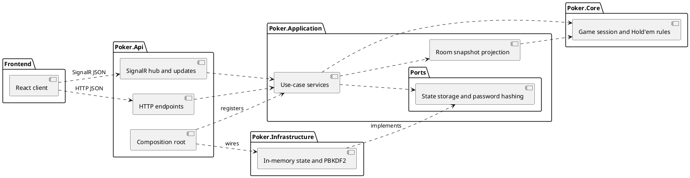
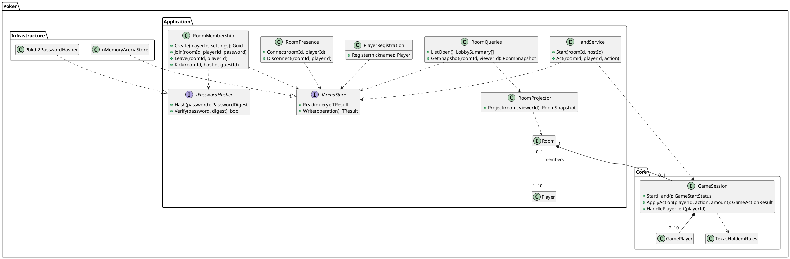

# Poker user stories and use cases

These stories and use cases describe the current Texas Hold’em prototype. See the [API contract](api.md) for transport details and the [test plan](test-plan.md) for validation.

## User stories

| ID | As a | I want to | So I can | Use case |
| --- | --- | --- | --- | --- |
| US-01 | New or returning player | Choose or reuse a nickname | Get to the lobby browser quickly | UC-01 |
| US-02 | Host | Create a password-protected table with a seat limit and blinds | Set up a game for my group | UC-02 |
| US-03 | Guest | See open tables and join with a password | Find my group and take a seat | UC-03 |
| US-04 | Host | See who is connected, remove guests, and start the game | Control who plays the first hand | UC-04 |
| US-05 | Player | See my private cards, the public board, and the available betting actions | Make decisions on my turn | UC-05 |
| US-06 | Player or host | Review the result and deal again when enough players have chips | Continue playing from the same table | UC-06 |
| US-07 | Returning player or spectator | Find and reconnect to my saved game | Resume playing or watch the remaining hands | UC-07 |
| US-08 | Player | Step away from a table or permanently abandon it | Keep my seat for later or free it for a new game | UC-08 |

## Use cases

### UC-01 · Set a nickname

| Field | Detail |
| --- | --- |
| Author | Project documentation |
| Primary actor | New or returning player |
| Prerequisites | The browser can reach the API. |
| Trigger | The player opens Poker and chooses **Look for lobbies**. |
| Actions | 1. Enter or reuse a nickname. 2. The API validates the nickname and sets an HttpOnly seat cookie. 3. The browser saves the nickname locally and opens the lobby browser. |
| Alternate flows | Invalid nicknames prompt the player to correct the input. After a server restart, the app can register a new seat using the saved nickname. |
| Outcome | The player can create or join a lobby. |

### UC-02 · Create a lobby

| Field | Detail |
| --- | --- |
| Author | Project documentation |
| Primary actor | Host |
| Prerequisites | The player has registered a nickname and has no current lobby. |
| Trigger | The player selects **Create lobby**. |
| Actions | 1. Enter a lobby name and password. 2. Set capacity from 2 to 10 and optionally adjust the blinds. 3. The server validates the settings, hashes the password, and seats the creator as host. 4. The browser opens the waiting room and connects to live updates. |
| Alternate flows | Invalid settings or an existing lobby membership prevent creation. |
| Outcome | The table is visible in the open lobby list and accepts guests with its password. |

### UC-03 · Browse and join a lobby

| Field | Detail |
| --- | --- |
| Author | Project documentation |
| Primary actor | Guest |
| Prerequisites | The guest has a seat ID, is outside any lobby, and knows the selected lobby’s password. |
| Trigger | The guest selects **Join** on an open lobby. |
| Actions | 1. Check the lobby name and occupancy. 2. Enter the password. 3. The server checks membership, capacity, start status, and password. 4. The guest enters the waiting room and existing members receive an update. |
| Alternate flows | The dialog reports a wrong password. If the lobby fills, starts, or closes before the request is processed, the join fails. |
| Outcome | The guest has a seat and can receive member-specific snapshots. |

### UC-04 · Manage the waiting room and start

| Field | Detail |
| --- | --- |
| Author | Project documentation |
| Primary actor | Host |
| Supporting actors | Guests |
| Prerequisites | The host is in a waiting room. Starting requires at least two seated players. |
| Trigger | The host selects **Kick** for a guest or **Start game**. |
| Actions | 1. Review player names and connection status. 2. Optionally remove a guest while the lobby is open. 3. Request a start. 4. The server closes the lobby to new joins and waits for all seated players to connect. 5. The server deals private cards and posts blinds. |
| Alternate flows | The server rejects non-host requests. If someone leaves during the initial connection wait and only one player remains, the lobby reopens. |
| Outcome | The table enters its first betting round once the connection requirement is met. |

### UC-05 · Take a betting turn

| Field | Detail |
| --- | --- |
| Author | Project documentation |
| Primary actor | Player whose turn it is |
| Prerequisites | A hand is active and all current members are connected. |
| Trigger | The table indicates **Your turn**. |
| Actions | 1. Read private cards, the board, chip counts, and the current bet. 2. Fold, check, call, or raise as available. A raise amount is the increment above the current table bet. 3. The server validates the action, updates chips and turn order, and publishes each player’s snapshot. |
| Alternate flows | The server rejects an out-of-turn or invalid action. A short call commits the player’s remaining chips. A disconnected member pauses play. |
| Outcome | The next player acts, the next street is dealt, or the hand ends. Opponents’ hole cards remain private. |

### UC-06 · Review the result and deal again

| Field | Detail |
| --- | --- |
| Author | Project documentation |
| Primary actors | Players reviewing the result and the host dealing again |
| Prerequisites | All opponents folded, betting finished on the river, or remaining betting is resolved by all-ins. |
| Trigger | The server settles the completed hand. |
| Actions | 1. The server awards the pot to the remaining player or evaluates the eligible hands and settles main and side pots. 2. Players see payouts, the final pot, and the public cards dealt. 3. The host selects **Deal next hand**. 4. The server rotates the dealer and clears the previous result as it deals. |
| Alternate flows | Fewer than two members with chips ends the game and clears its saved IDs. The next hand requires at least two available players with chips. Busted seats can spectate while the game continues. |
| Outcome | A new hand starts at the same table or the finished result stays visible. |

### UC-07 · Reconnect to a saved game

| Field | Detail |
| --- | --- |
| Author | Project documentation |
| Primary actor | Returning player or spectator |
| Prerequisites | The browser still has its seat cookie. The seat belongs to an ongoing game. |
| Trigger | The player selects **Reconnect** in the lobby browser, refreshes the table, or loses the live connection. |
| Actions | 1. The browser checks membership and the saved game/session pair with HTTP. 2. It reconnects to SignalR and receives a member-specific snapshot. 3. A returning seat can join the next deal with its remaining chips. A busted seat watches without participating in betting. |
| Alternate flows | The app retries a temporary connection failure. If the game ends, the browser clears the saved IDs automatically. After an API restart, the browser clears its stale game on its next check. |
| Outcome | The player recovers the same seat while the game and membership are active. |

### UC-08 · Step away or abandon a game

| Field | Detail |
| --- | --- |
| Author | Project documentation |
| Primary actor | Lobby member |
| Prerequisites | The player still occupies a lobby seat. |
| Trigger | The player confirms **Leave lobby** in an active game or **Abandon game** for the saved seat. |
| Actions | 1. Stepping away folds the current hand and sits the player out while preserving their remaining stack. 2. The browser returns to the lobby browser and displays the saved game. 3. Abandoning releases membership and forfeits the stack. |
| Alternate flows | If the host abandons an active game, the server chooses a random remaining member as host. The last abandonment closes the room. Leaving a waiting room removes the seat immediately. |
| Outcome | The player can reconnect or abandon the saved game. Creating or joining another lobby is available after abandonment or game completion. |

## Proposed SOLID refactor

Today, `Api.Services.Arena` manages registration, membership, presence, game orchestration, room snapshots, password hashing, and the in-memory state lock. The proposed design keeps the existing poker engine in `Core` and moves the orchestration into an application library. The API remains the composition root for wiring implementations together.

### UML package diagram

The arrows indicate dependencies. `Poker.Application.Ports` is a namespace inside the proposed application project. The React client depends on the wire contract over HTTP and SignalR.

### UML class diagram

This model shows proposed responsibilities and representative operations. Registration and room operations share the same transaction boundary because one player can occupy at most one room.

### Refactor sequence

1. Introduce the application project with typed, member-specific snapshots. Route HTTP and SignalR through the same query path. Keep card privacy and the existing camelCase JSON contract covered by integration tests.
2. Move in-memory state and password hashing behind small interfaces. Keep registration, the single-room-per-player check, and room mutation atomic under one transaction boundary. Return detached snapshots and publish network updates after releasing the lock.
3. Extract registration, membership, gameplay commands, and presence into their own services. Share internal lifecycle operations for the first deal so start requests, reconnects, and departures apply the same rules. Keep `Core` responsible for game rules and payout calculation.
4. Wire implementations in the API project and migrate one flow at a time. Run the backend and browser suites after each extraction, including concurrent joins and reconnects. Keep the application contracts focused on Poker’s existing use cases so implementations can be substituted without changing caller expectations.
